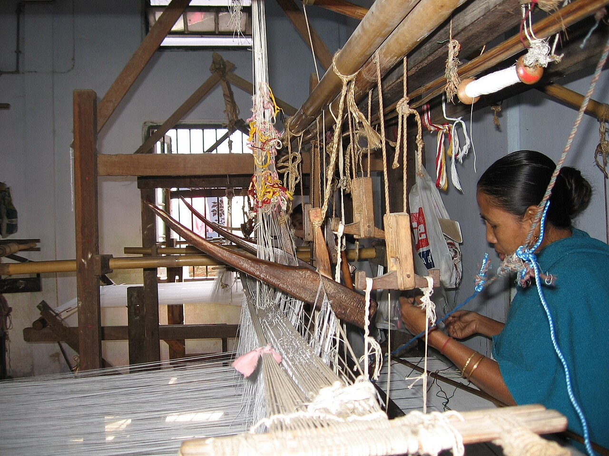
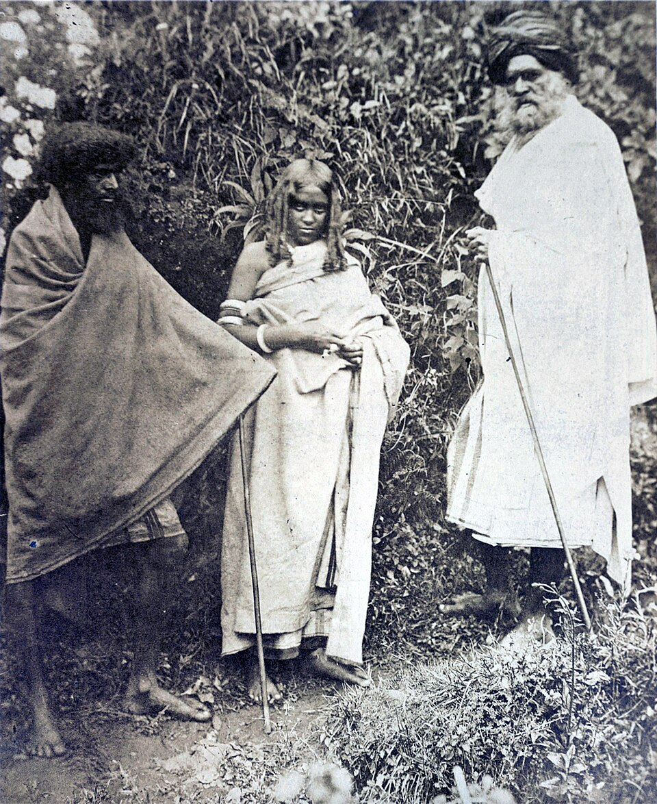
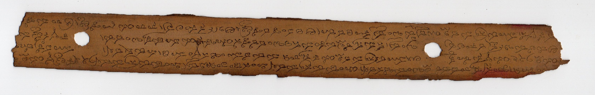
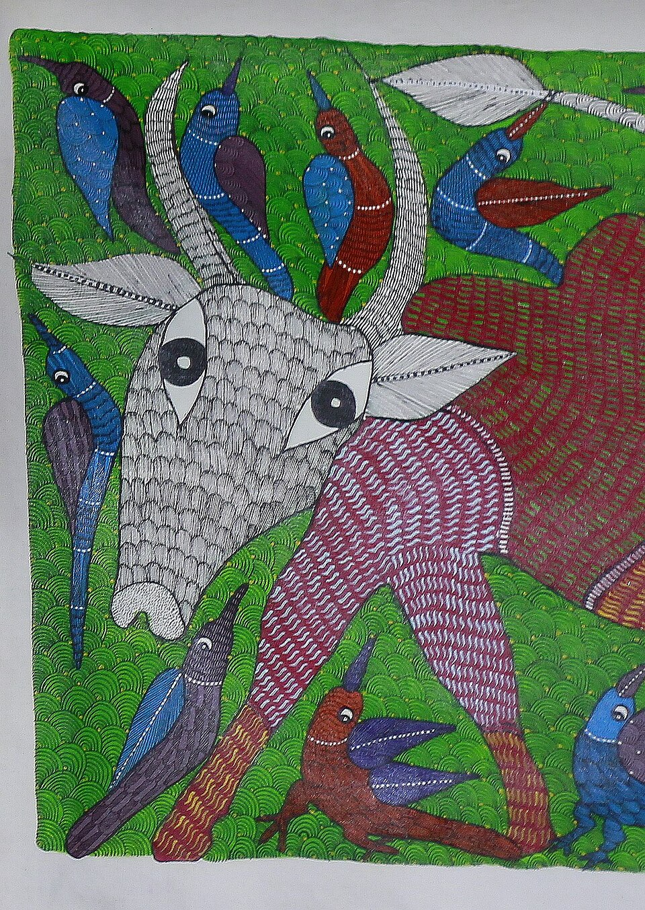
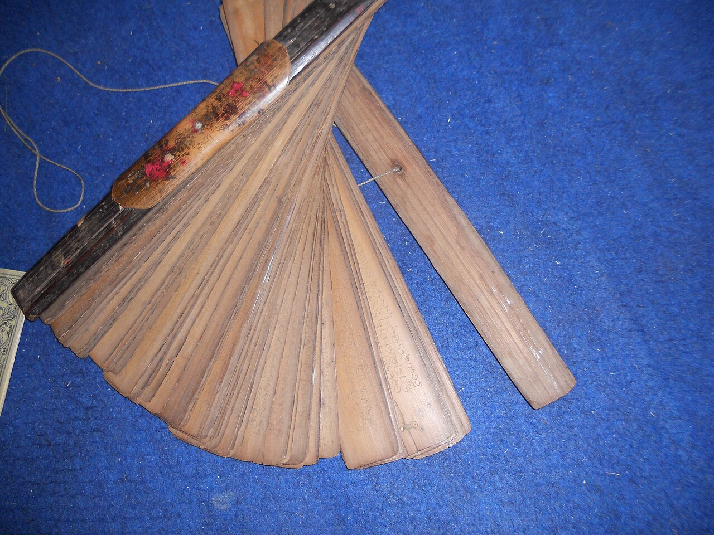
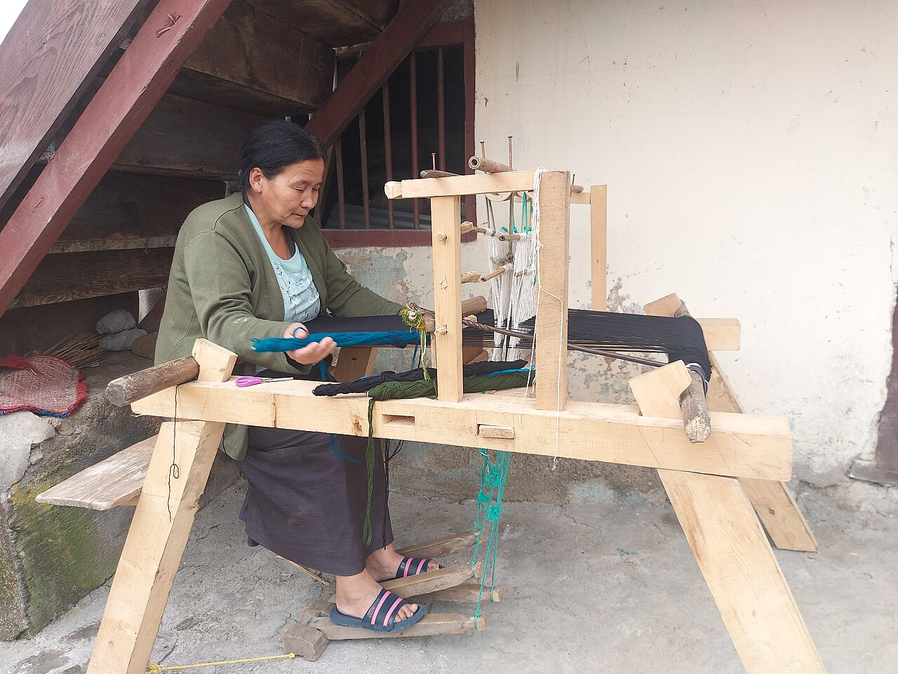
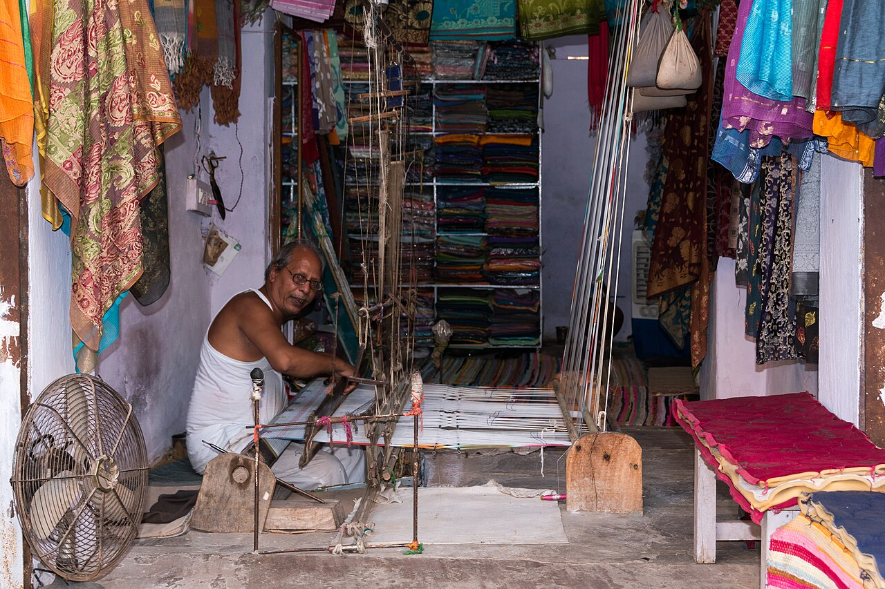

<div align="center">

<h1>BhashaVerse</h1>
<p><em>India Language &amp; Cultural Heritage Archive</em></p>

<p>
  <strong>An archive of India’s underrepresented languages: words, voices, scripts and photographs, shared with community consent.</strong>
</p>

<p>
  <code>ತುಳು</code> &nbsp;·&nbsp; <code>गोंडी</code> &nbsp;·&nbsp; <code>ᱥᱟᱱᱛᱟᱲᱤ</code> &nbsp;·&nbsp; <code>𑃐𑃦𑃝</code> &nbsp;·&nbsp; <code>କୁଇ</code> &nbsp;·&nbsp; <code>தோதா</code> &nbsp;·&nbsp; <code>মিশিং</code> &nbsp;·&nbsp; <code>भीली</code> &nbsp;·&nbsp; <em>Koda (Kora)</em>
</p>

<p>
  <a href="https://anubhabhalder06.github.io/BhashaVerse/"><strong>Visit the Live Archive →</strong></a>
  &nbsp;&nbsp;|&nbsp;&nbsp;
  <a href="https://anubhabhalder06.github.io/BhashaVerse/map.html">Explore Language Map</a>
  &nbsp;&nbsp;|&nbsp;&nbsp;
  <a href="https://anubhabhalder06.github.io/BhashaVerse/languages.html">Language Directory</a>
  &nbsp;&nbsp;|&nbsp;&nbsp;
  <a href="https://anubhabhalder06.github.io/BhashaVerse/contribute.html">Contribute</a>
</p>

</div>

---

<p align="center">
  
</p>
<p align="center">
  <em>“The loom remembers the river’s old name.”</em><br>
  <sub>Hero archival plate: Assamese handloom weaver · Photo by <a href="https://commons.wikimedia.org/wiki/File:Assamese_woman_using_traditional_handloom.jpg">Deepraj</a> (CC BY 2.5)</sub>
</p>

---

## About the Website

**BhashaVerse** is a community-guided digital archive prototype built to preserve India’s lesser-documented, regional, and indigenous languages alongside their living visual and oral heritage. Rather than treating language purely as isolated dictionary rows, the archive connects **scripts, spoken cadence, manuscripts, textiles, regional geography, and oral histories** under transparent attribution and consent rules.

Inside the website, visitors can:
- **Compare living scripts side by side** on the Home *Signature Poster*, rotating shared core concepts (*water*, *home*, *song*) across eight documented scripts with Romanisation, IPA, and optional spoken-tone previews.
- **Explore 9 language communities** across coastal Karnataka, the Central Deccan, Jharkhand, Odisha, the Nilgiris, Assam, western India, and West Bengal—including an open verification slot for **Koda (Kora)** without fabricated placeholder words.
- **Navigate an interactive map of India** spanning 35 states and union territories with zoom/pan controls and regional language inspectors.
- **Browse rights-labelled manuscripts & photographs** in the Digital Library and monochrome Gallery, where restricted or metadata-only items never expose unauthorised files.
- **Submit corrections, words, audio, or stories** through a consent-checked contribution flow backed by a preview moderation queue.

---

## Design & Artistic Vision

BhashaVerse is art-directed as a **contemporary archival broadsheet and linguistic specimen book** rather than a conventional web dashboard. Every visual choice serves readability, cultural dignity, and editorial calm:

### 1. Archival Paper & Carbon Ink Palette (`css/tokens.css`)
- **Warm Rag Paper (`#EFEDE8`) & Vellum Surface (`#E3E0D8`):** Replaces sterile `#FFFFFF` glare with the quiet warmth of archival rag paper, overlaid with a subtle two-layer `radial-gradient` paper grain (`.bv-paper-grain`).
- **Carbon Ink Spreads (`#0E0E0E` & `#181816`):** Only key focal spreads—such as the Home *Eight-Script Signature Poster* and the *Featured Specimen Verso*—invert onto deep ink, creating dramatic broadsheet contrast against `#EFEDE8` paper text.
- **Restrained Semantic Colour:** Chromatic colour is deliberately withheld from chrome and navigation. Per-language hues (`--lang-accent`) appear strictly on interactive audio controls, map pins, and script accent details.

### 2. Typography Across Nine Writing Systems
- **Editorial Serif Display (`Fraunces` & `Instrument Serif`):** Expressive literary serif headlines pair with **Plus Jakarta Sans** set at an accessible `18px` minimum body size (`1.6` line height).
- **Archival Marginalia (`Caveat`):** Handwritten field notes annotate plates and spreads without interrupting hierarchy.
- **Pan-Indic Script Stack (`--font-indic`):** Pairs `Noto Sans` typefaces across **Ol Chiki**, **Sora Sompeng**, **Masaram Gondi**, **Gunjala Gondi**, **Devanagari**, **Kannada**, **Oriya**, **Tamil**, and **Bengali**, paired with runtime `canvas` glyph-rendering verification (`canRenderChar`) so missing OS fonts never display silent broken boxes.

### 3. Tactile Print Craft & Geometry
- **SVG Ink Displacement:** Subtle `<feTurbulence>` and `<feDisplacementMap>` SVG filters soften the edges of the Home hero’s Mishing script word (`মিশিং`, scale `2.5`) and give catalogue stamps (`BV-REC-041`) an authentic rubber-ink impression.
- **Asymmetrical Bleed & Hairlines:** The hero handloom photograph bleeds cleanly to the right viewport edge with `32px` left-side rounding, while `1px` editorial rules (`rgba(14,14,14,0.18)`) separate sections without heavy drop shadows or rounded card clutter.
- **Ethical Visual Grammar:** On the map and directory, verified samples carry solid markers while **Koda (Kora)** uses a **dashed hollow ring** and `"Awaiting community verification"` label—making missing community verification visible by design rather than filling gaps with guesses.

---

## Visual Plates from the Archive

On the live site, archival and field photographs are unified under monochrome high-contrast treatment with subtle paper grain and full Wikimedia Commons attribution:

<table>
  <tr>
    <td width="33%" valign="top">
      
      <br><sub><strong>Nilgiri 1871 Witness (Toda)</strong><br>Madras School of Arts · Public domain</sub>
    </td>
    <td width="33%" valign="top">
      
      <br><sub><strong>Coastal Talegari Folio (Tulu)</strong><br>Ananda Devaraj · CC BY-SA 4.0</sub>
    </td>
    <td width="33%" valign="top">
      
      <br><sub><strong>Gond Line-and-Dot Study (Gondi)</strong><br>Sumita Roy Dutta · CC BY-SA 4.0</sub>
    </td>
  </tr>
  <tr>
    <td width="33%" valign="top">
      
      <br><sub><strong>Palm-Leaf Bundle (Sora / Odia)</strong><br>Manoj Choudhury · CC BY-SA 3.0</sub>
    </td>
    <td width="33%" valign="top">
      
      <br><sub><strong>Lachen Loom Practice</strong><br>Jirah P Lepcha · CC BY-SA 4.0</sub>
    </td>
    <td width="33%" valign="top">
      
      <br><sub><strong>Warp &amp; Shuttle Craft, Bundi</strong><br>Daniel Villafruela · CC BY-SA 3.0</sub>
    </td>
  </tr>
</table>

---

## Documented Languages (`js/data.js`)

| Language | Family | Primary Region | Script(s) | Archive Status |
| :--- | :--- | :--- | :--- | :--- |
| **Tulu** (`ತುಳು`) | Dravidian | Karnataka / Kerala | Tigalari / Kannada | Sample lexicon & talegari folio |
| **Gondi** (`गोंडी`) | Dravidian | Central Deccan | Devanagari / Masaram | Sample lexicon & Gond art study |
| **Santali** (`ᱥᱟᱱᱛᱟᱲᱤ`) | Austroasiatic | Jharkhand / Odisha | Ol Chiki | Sample lexicon & script chart |
| **Sora** (`𑃐𑃦𑃝` / `ସଉରା`) | Austroasiatic | Odisha / Andhra | Sora Sompeng & Odia | Sample lexicon & palm-leaf bundle |
| **Kui** (`କୁଇ`) | Dravidian | Odisha | Odia / Oral | Sample lexicon & cultural context |
| **Toda** (`தோதா`) | Dravidian | Tamil Nadu | Tamil / Phonetic | Sample lexicon & 1871 archival plate |
| **Mishing** (`মিশিং`) | Tibeto-Burman | Assam / Arunachal | Assamese / Latin | Sample lexicon & hero handloom plate |
| **Bhili** (`भीली`) | Indo-Aryan | Gujarat / MP / Rajasthan | Devanagari / Gujarati | Sample lexicon & textile craft study |
| **Koda (Kora)** | Austroasiatic | West Bengal | *To be verified* | **Awaiting community verification** |

---

## Archive Pages (20 Static Routes)

| Section | Pages | Purpose |
| :--- | :--- | :--- |
| **Explore & Read** | `index.html`, `languages.html`, `language-profile.html`, `map.html`, `search.html` | Hero showcase, 8-script rotating poster, filterable directory, dynamic `?lang=` profiles, 35-region India SVG map, and cross-archive search |
| **Collections** | `library.html`, `library-item.html`, `gallery.html`, `audio.html` | Rights-gated digital library (`CC BY-SA` vs. `Restricted` / `Metadata only`), archival B/W photography plates, and transcript-enabled audio showcase |
| **Context** | `history.html`, `culture.html`, `stories.html` | Script timelines, community heritage contexts, festivals, crafts, and oral-memory story slots |
| **Stewardship** | `contribute.html`, `admin.html`, `about.html`, `guidelines.html`, `copyright.html`, `privacy.html`, `terms.html`, `contact.html` | Consent-first contribution form, browser-side moderation queue preview, editorial governance, and policy documentation |

---

## Technical Architecture

BhashaVerse is built with **zero build tools, zero framework lock-in, and zero external runtime dependencies**—making long-term archival preservation, offline inspection, and static hosting straightforward.

### 1. Layered CSS Design System
- `css/tokens.css` defines the complete palette, type stacks, spacing scale (`--space-1` to `--space-4`), and accessible `18px` base sizing.
- `css/base.css` provides reset rules, keyboard skip links, high-contrast `:focus-visible` outlines, and `prefers-reduced-motion` safeguards.
- `css/editorial.css` implements the `1200px` shared container grid, right-bleed hero layout (`--bleed`), responsive navigation with an accessible `More` disclosure menu, and editorial spreads.

### 2. Data-Driven Client Rendering (`js/data.js` & `js/main.js`)
- `window.BhashaVerseData` acts as the single source of truth for languages, lexical triads (`water`, `home`, `song`), category glyphs, library records, gallery plates, stories, and heritage contexts.
- Home hero fact counts (number of languages and verified scripts) are **computed dynamically from `LANGUAGES`** rather than hard-coded.
- URL query routing drives reusable templates without server rendering: `language-profile.html?lang=<id>`, `library-item.html?id=<record>`, `search.html?q=<term>`, and `contribute.html?lang=<id>`.

### 3. Cartographic Vector Map (`js/india-geo.js`)
- `window.BhashaVerseGeo` stores vector SVG path data for **35 Indian states and union territories** projected into a `640 × 720` cartographic viewport (`67°E` to `98°E`) using cosine-adjusted coordinates and Ramer–Douglas–Peucker path simplification.
- Supports interactive zoom (`+` / `−` / `Reset`), coordinate projection (`lat`/`lng` to SVG space), keyboard-focusable pins, and an accessible side inspector.

### 4. Web Audio Synthesis & Runtime Glyph Checks
- Audio preview buttons synthesize clean two-note sine cadences via the **Web Audio API** (`AudioContext`) strictly on user click—never autoplaying—until community-recorded `.mp3`/`.wav` field audio is deposited.
- `canRenderChar()` inspects rendered glyph pixel ink on an off-screen `<canvas>` to detect unsupported complex Indic fonts and display clear notices when fallback script rendering is needed.

### 5. Automated GitHub Pages Deployment
- `.github/workflows/deploy-pages.yml` runs a two-stage GitHub Actions pipeline (`build` → `deploy`) that stages HTML, CSS, JS, `assets/`, and `.nojekyll` into `_site/` and publishes via `actions/upload-pages-artifact@v3` and `actions/deploy-pages@v4`.

---

## Directory Layout

```text
BhashaVerse/
├── .github/workflows/
│   └── deploy-pages.yml      # Two-stage GitHub Actions Pages deployment
├── assets/images/            # 7 Wikimedia Commons plates + manifest.json
├── css/
│   ├── tokens.css            # Colour palette, typography & spacing tokens
│   ├── base.css              # Accessibility primitives, focus & motion defaults
│   └── editorial.css         # Multi-page editorial broadsheet styles
├── js/
│   ├── data.js               # Structured datasets (languages, library, gallery, stories)
│   ├── india-geo.js          # 35-state/UT India vector geometry + coordinate helpers
│   └── main.js               # UI hydration, search, map inspector, audio & contribution flow
├── index.html                # Home broadsheet + hero + rotating 8-script poster
└── *.html                    # 19 additional archive, profile, map, and policy pages
```

---

## Running Locally

Open `index.html` directly, or serve the root folder with any static HTTP server:

```bash
git clone https://github.com/anubhabhalder06/BhashaVerse.git
cd BhashaVerse

# Python
python -m http.server 8080

# Or Node.js
npx serve .
```

Then visit `http://localhost:8080`.

---

## Stewardship & Prototype Notice

- Sample records, quotes, and synthesized tone previews on this prototype are **placeholders pending community verification and consent clearance**.
- `contribute.html` and `admin.html` persist preview submissions locally in browser `localStorage`; production deployment requires authenticated moderation, consent-ledger storage, and verified speaker recordings.
